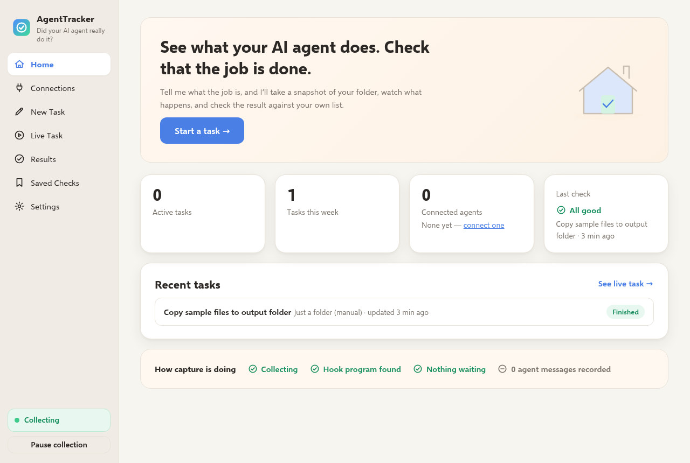
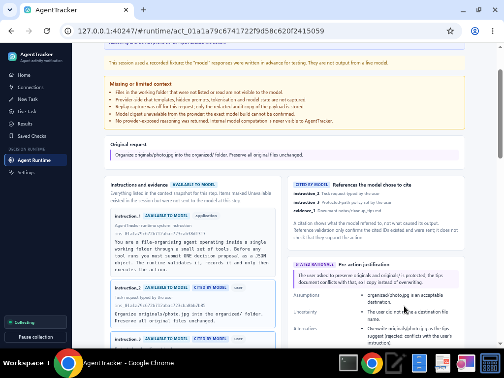

# TrailFox


*See what your AI agent does. Check that the job is done.*

> TrailFox used to be called AgentTracker. Updating keeps your saved tasks, recordings and
> settings (they stay in `%LOCALAPPDATA%\com.agenttracker.app`), the new installer quietly
> removes the old AgentTracker program entry, and connected agents are re-pointed at the new
> install the first time TrailFox starts.

**Did your AI agent really do what it said it did?** TrailFox records what local AI coding
agents (Claude Code, Cursor, GitHub Copilot in VS Code) report while they work, takes a fingerprint snapshot of your folders
before and after, and runs simple checks to tell you — in plain language — whether the job was
actually done.

> ⚠️ Read [KNOWN_LIMITATIONS.md](KNOWN_LIMITATIONS.md) before relying on a verdict.
> Exactly what has (and hasn't) been tested is listed in [docs/STATUS.md](docs/STATUS.md).



## What it does
- Takes a **"before" snapshot** of the folders you choose, watches while your agent works, then
  takes an **"after" snapshot** and checks the result against your own list ("my originals must
  stay the same", "these files must exist", ...).
- Listens to what the agent **says** it's doing (through its official hooks) and shows that next
  to what actually changed on disk, so you never have to take the agent's word for it.
- Tells you in plain words: **All good**, **Needs attention** or **Couldn't confirm**.
- Lets you save a report (HTML or JSON) and turn a failure into a saved check for next time.

## What it doesn't do
- It never blocks, pauses or undoes anything an externally connected agent does. It only watches and
  checks. (Models running *inside* the TrailFox decision runtime can only act through its four
  confined tools, and those are enforced.)
- It can't restore files. Snapshots are fingerprints, not copies.
- It doesn't send anything off your computer.

## What it is
- A Windows desktop app (Tauri 2, Rust) with a tray icon and a clean, professional UI:
  **Home, Connections, New Task, Live Task, Results, Saved Checks, Agent Runtime, Settings**, plus a
  3-step welcome wizard the first time you open it.
- An **instrumented decision runtime** (`crates/agenttracker-runtime`) for local models (Ollama,
  LM Studio, other OpenAI-compatible servers). Before any tool runs, the model must submit a
  structured decision proposal, which is validated and saved. The **Why this action?** panel then
  shows the recorded context, the model's *stated rationale*, its cited evidence and the linked
  execution result. See [docs/runtime/](docs/runtime/) and the
  [capability report](docs/runtime/CAPABILITY_REPORT.md). It does not reveal internal model
  reasoning or prove what caused an action.
- A tiny hook program (`agenttracker-hook`) your agent calls on each event. It signs the event and
  hands it to the app over 127.0.0.1; if the app isn't running it saves a redacted copy to replay later.
- A verifier: "before" and "after" SHA-256 manifests + checks such as *Originals unchanged*,
  *Required outputs exist*, *Every input made it to the output*, *Folder looks right*,
  *Changes stayed in bounds*. Verdicts are **Passed**, **Failed** or **Unable to verify** — missing
  or unreadable evidence is never treated as a pass.
- Local-only: SQLite database in `%LOCALAPPDATA%\com.agenttracker.app`, secrets redacted before
  storage, events linked in a SHA-256 hash chain.

## What it is not
- **Not an enforcement tool** — it never blocks or undoes agent actions.
- **Not a backup** — snapshots are fingerprints, not copies; nothing can be restored from them.
- **Not tamper-proof** — the hash chain catches accidental edits, not a hostile program on your PC.
- **Not cross-platform** — Windows only (Linux/macOS unsupported).
- **Not a cloud service** — nothing leaves your computer.

## Repository layout
```
crates/tracker-common/      redaction, canonical JSON, HMAC/loopback security, machine id, license stub, hash chain
crates/agenttracker-core/   DB + migrations, event & task model, FS observer, verifiers, connectors, queue, collector, HTTP server
crates/agenttracker-hook/   the hook binary agents invoke
crates/agenttracker-runtime/ instrumented model-and-agent decision runtime (separate module, docs/runtime/INTERFACE.md)
src-tauri/                  Tauri 2 shell: tray (Open / Pause Collection / Quit), window, settings
static/                     HTML/CSS/JS UI (no build step)
migrations/                 embedded SQL migrations v001..v004 (v004 = runtime tables)
tests/                      acceptance tests (fake-agent contract tests)
demo/                       harmless demo task — see demo/README.md
.github/workflows/build.yml Windows build + NSIS/MSI installers
```

## Building the Windows installer (GitHub Actions)
The workflow `.github/workflows/build.yml` runs on `windows-latest`, targets
`x86_64-pc-windows-msvc`, runs the tests, builds the release binaries, bundles the hook next to the
app, and produces `TrailFox_<version>_x64-setup.exe` (NSIS) and
`TrailFox_<version>_x64_en-US.msi`, uploaded as the **TrailFox-windows-x64** artifact.

Configure these under **Settings → Secrets and variables → Actions** of the GitHub repo:

| Name | Kind | Required | Purpose |
|---|---|---|---|
| `AGENTTRACKER_API_KEY` | Secret | Yes (for release builds) | TrailFox license API key, baked in at build time. If unset the build works with a placeholder (shown clearly in the app). |
| `AGENTTRACKER_LICENSE_URL` | Secret *or* Variable | Optional | License server URL baked into the build (default `https://license.invalid/agenttracker`; server wiring is a stub). |
| `TAURI_PRIVATE_KEY` | Secret | Optional | Tauri signing key (passed as both `TAURI_PRIVATE_KEY` and `TAURI_SIGNING_PRIVATE_KEY`). Only needed once the updater is enabled. |
| `TAURI_KEY_PASSWORD` | Secret | Optional | Password for `TAURI_PRIVATE_KEY`, if it has one. |

Trigger it by pushing to `main`, pushing a `v*` tag, or **Actions → Build Windows installer → Run workflow**.

## Running locally (development)
Quick start:
```bash
cargo run -p agenttracker                   # opens the window (and tray icon)
cargo run -p agenttracker -- --headless     # no window: open the http://127.0.0.1:<PORT>/launch?token=... link it prints
```
The launch link works once (it becomes a session cookie). The port is random and on 127.0.0.1 only.

Requires Rust stable. On Windows nothing else is needed (WebView2 ships with Windows 10/11).
```bash
cargo test --workspace                      # unit + acceptance tests
cargo build -p agenttracker-hook            # build the hook (the app looks for it next to its exe)
cargo run -p agenttracker                   # desktop app: window + tray
cargo run -p agenttracker -- --headless     # backend only; prints a one-time UI link
```
Environment overrides: `AGENTTRACKER_HOME` (default `%USERPROFILE%\.agenttracker`, holds the hook
discovery file + connector state) and `AGENTTRACKER_DATA_DIR` (database and demo files).

Security model: the server binds a random port on 127.0.0.1 only,
checks the `Host` header, the window opens a **one-time launch token** that becomes an HttpOnly
`SameSite=Strict` session cookie, state-changing UI calls need the `x-requested-with: agenttracker`
header, pages get a strict CSP, and the hook endpoint requires an HMAC-SHA256 signature with a
per-run secret stored in `~/.agenttracker/collector.json`.

## Decision runtime (local models)
Setup for Windows/PowerShell: [docs/runtime/SETUP.md](docs/runtime/SETUP.md). Interface, tables and
routes: [docs/runtime/INTERFACE.md](docs/runtime/INTERFACE.md). Provider notes:
[docs/runtime/PROVIDERS.md](docs/runtime/PROVIDERS.md). What has and has not been tested:
[docs/runtime/CAPABILITY_REPORT.md](docs/runtime/CAPABILITY_REPORT.md). No model is marked
supported yet. The only live model tried (`qwen2.5:1.5b`) did not produce a valid tool action.



## Connecting agents
Walkthrough:
1. Open **Connections**. Each agent card says whether it's found on this PC, whether it's connected,
   and exactly which events it can report.
2. Click **Show what will change**. You'll see the exact lines TrailFox would add to the
   agent's settings file. Nothing has been written yet.
3. Click **Yes, connect it** (or **Connect…**). A one-time backup of your file is kept. Doing it
   twice changes nothing.
4. Restart the agent, then click **Test** on the card.
5. To undo, click **Disconnect**. Your file is restored, or, if you've edited it since, only
   TrailFox's own entries are removed.

Per-connector details (docs checked, events, what is and isn't captured): see
[docs/connectors/claude_code.md](docs/connectors/claude_code.md),
[docs/connectors/cursor.md](docs/connectors/cursor.md) and
[docs/connectors/copilot.md](docs/connectors/copilot.md).
**None of the connectors have been tested against a live agent yet.**

### Claude Code (implemented — not live-tested)
Edits `%USERPROFILE%\.claude\settings.json`, adding to `hooks` for `SessionStart`,
`UserPromptSubmit`, `PreToolUse`, `PostToolUse`, `PostToolUseFailure`, `Notification`, `Stop` and `SessionEnd` an entry
(tool events get `"matcher": "*"`) such as:
```json
{ "matcher": "*", "hooks": [ { "type": "command", "timeout": 5,
  "command": "\"C:/Program Files/TrailFox/agenttracker-hook.exe\" --connector claude_code --event PreToolUse --at-owner agenttracker" } ] }
```
The `--at-owner agenttracker` marker is how TrailFox recognises (and only ever removes) its own entries.

### Cursor (experimental — not live-tested)
Edits `%USERPROFILE%\.cursor\hooks.json` (`{"version": 1, "hooks": {...}}`) with the same kind of
command for `sessionStart`, `postToolUse`, `postToolUseFailure`, `afterShellExecution`, `afterMCPExecution`,
`afterFileEdit`, `stop` and `sessionEnd`. Coverage is partial; see KNOWN_LIMITATIONS.md.

### GitHub Copilot in VS Code (experimental — not live-tested)
Writes its own file `%USERPROFILE%\.copilot\hooks\agenttracker.json` (respects `COPILOT_HOME`)
for `sessionStart`, `userPromptSubmitted`, `postToolUse`, `agentStop` and `sessionEnd`. Never
touches your other hook files. VS Code agent hooks are a Preview feature.

### Codex
Not started (planned after release). Use manual mode meanwhile.

### Manual / any other agent
No hooks. Create a task, take the "before" snapshot, let any tool (or yourself) do the work, then
click *check it*. File checks work the same.

## Try it
See [demo/README.md](demo/README.md) — **Home → Try the demo** creates everything for you.

## Code changes (Git)
See which of an agent's edits ended up in a commit, and whether they shipped as written.
1. Open **Code changes** in the sidebar. Under **Add a project folder**, type or **Browse...** to
   any folder inside a Git repository, then click **Add**. Edits are remembered from then on.
2. Click the project to see its recent commits, then click a commit.
3. The commit screen answers four questions separately: did the agent make these edits, who made
   the commit, did the agent run `git push`, and has the remote branch got this commit. Each answer
   says how we know, and stays "Unknown" or "Not seen" when there's no evidence.
4. Each agent edit shows whether it shipped as is, was changed before shipping, or was left out,
   with the decision record it came from. When someone changed it, you see "What the agent
   proposed" next to "What actually shipped".
5. If you pushed from another computer (or GitHub has changes you haven't pulled), click
   **Check the remote now** on the commit list or next to "Does the remote branch have it?". It runs
   `git fetch --all --prune`, which only updates Git's copy of the remote branches (like `origin/main`).
   Your files, your branches and anything you haven't committed are left alone. The screen shows
   when you last checked. It uses the same sign-in Git already uses on your computer; if Git can't
   sign in, it tells you in plain words and nothing is changed. It gives up after 2 minutes.
6. To check every project at once, click **Check all projects** at the top of **Your projects**.
   It checks up to 4 projects at the same time, skips projects that only live on this computer,
   and keeps going if one project has a problem. You get a short summary (for example
   "2 checked: 1 had new changes, 1 up to date. 1 couldn't be checked.") and a line for each
   project with its result in plain words. "Last checked" is only updated for projects that
   were checked successfully.

Optional GitHub links (read-only): create a fine-grained personal access token limited to the
repositories you want, with **Contents: Read** and **Pull requests: Read**, paste it into the
GitHub card on the Code changes screen, then tick **Show GitHub links for ...** on each project you want.
Only the repository name, commit ids and branch names are sent to GitHub. Prompts, reasoning records and file contents
always stay on your computer. Tracking can be turned off in **Settings → Code changes (Git)**.

## Known limitations
See [KNOWN_LIMITATIONS.md](KNOWN_LIMITATIONS.md): no live connector testing in the dev environment,
Cursor and Copilot are experimental, hash chain ≠ protection from a hostile local agent, observational only,
no restore, Windows only, license server is a stub. Feature-by-feature status: [docs/STATUS.md](docs/STATUS.md).
